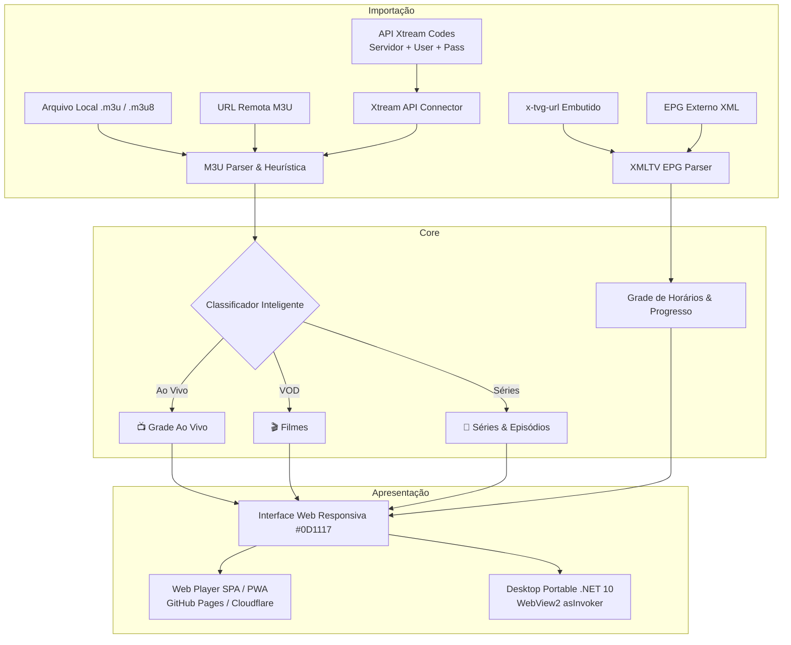

<p align="center">
  
</p>
<h1 align="center">FluiStream</h1>
<p align="center">
  <b>Reprodutor moderno e fluido de listas M3U/M3U8 com EPG XMLTV, Xtream Codes API, Web Responsiva e Desktop Portable.</b><br/>
  <i>Modern fluid M3U/M3U8 playlist player with XMLTV EPG, Xtream Codes API, Responsive Web and Portable Desktop.</i><br/>
  <i>Reproductor moderno y fluido de listas M3U/M3U8 con EPG XMLTV, API Xtream Codes, Web Responsiva y Desktop Portable.</i>
</p>

<p align="center">
  <a href="https://cesarovies.github.io/FluiStream/"></a>
  <a href="https://github.com/CesarOvies/FluiStream/releases"></a>
  <a href="https://cesarovies.github.io/FluiStream/llms.txt"></a>
  
  
  
  <a href="LICENSE"></a>
</p>

<p align="center">
  🌐 <a href="https://cesarovies.github.io/FluiStream/"><strong>Usar Versão Web</strong></a> •
  💻 <a href="https://github.com/CesarOvies/FluiStream/releases"><strong>Baixar App Desktop Portable</strong></a> •
  🤖 <a href="https://cesarovies.github.io/FluiStream/llms.txt"><strong>llms.txt (AI Index)</strong></a>
</p>

---

## Sumário
1. [Visão Geral](#visão-geral)
2. [Recursos Principais](#recursos-principais)
3. [Arquitetura & Fluxo](#arquitetura--fluxo)
4. [Como Usar](#como-usar)
5. [Compilação e Testes](#compilação-e-testes)
6. [Governança e Segurança](#governança-e-segurança)

---

## Visão Geral

O **FluiStream** é um reprodutor de mídia e listas IPTV (M3U / M3U8) de alto desempenho projetado segundo os padrões de engenharia de software de **Cesar Ovies**.

Ele resolve as principais limitações dos players convencionais combinando uma interface web 100% client-side (PWA) de carregamento instantâneo com um executável desktop portátil (`.exe`) em **User-Space (`asInvoker`)** que dispensa instaladores, não exige privilégios de Administrador e remove restrições de CORS ao se conectar a servidores de streaming remotos.

> [!NOTE]
> O **FluiStream** é um reprodutor de mídia neutro. Ele não inclui e nem fornece listas, canais ou conteúdos de terceiros; o usuário é responsável por carregar suas próprias listas legítimas.

---

## Recursos Principais

### 1. Organização Inteligente em 3 Seções
- 📺 **Ao Vivo (Live TV)**: Canais de televisão abertos e por assinatura, esportes, notícias e variedades com guia de programação em tempo real.
- 🎬 **Filmes (VOD)**: Catálogo de filmes sob demanda organizados por categorias e gêneros.
- 🍿 **Séries (Series & Shows)**: Detecção automática de séries com agrupamento inteligente por Temporadas e Episódios (ex: `S01E02`, `1x05`, `Temporada 1`).

### 2. Guia Eletrônico de Programação (EPG XMLTV)
- **EPG Embutido**: Detecção e extração automática de URLs de EPG declaradas na própria lista (`#EXTM3U x-tvg-url="..."` ou `url-tvg="..."`).
- **EPG Externo**: Possibilidade de anexar EPG externo via URL XMLTV ou envio de arquivo `.xml`.
- **Exibição em Tempo Real**: Cálculo dinâmico do programa em exibição no momento, percentual decorrido na barra de progresso e lista dos próximos programas agendados.

### 3. Três Formas de Importação Flexíveis
1. **Arquivo Fixo Local**: Upload ou arraste (Drag & Drop) de arquivos `.m3u` ou `.m3u8`.
2. **URL Remota**: Download direto da lista com suporte a proxy CORS configurável.
3. **API Xtream Codes**: Autenticação nativa utilizando Nome da Lista, Usuário, Senha e URL do Servidor (consumindo `player_api.php`, `get.php` e `xmltv.php`).

### 4. Player de Vídeo Moderno & Fluido
- Motor HLS.js integrado para reprodução contínua de streams `.m3u8` e contêineres MP4 / MKV.
- Ajuste de **Proporção de Tela (Aspect Ratio)**: Automático, 16:9 (Widescreen), 4:3 (Clássico) e Preencher (Fill).
- Suporte nativo a **Picture-in-Picture (PiP)** e **Tela Cheia (Fullscreen)**.
- Integração com **Media Session API** (controles no teclado e na central de mídia do Windows/macOS/Android).
- Sistema de **Favoritos** persistente e histórico de canais recentes.

### 5. Padrões Cesar Ovies
- **Design GitHub Dark Theme** (`#0D1117`, `#161B22`, `#30363D`, `#238636`).
- **i18n Obrigatório em 3 Idiomas**: Português do Brasil (`pt-BR`), Inglês (`en-US`) e Espanhol (`es`).
- **100% User-Space**: Sem exigência de permissões elevadas de Administrador.
- **Auto-Atualização Desktop**: `UpdateService` com verificação de releases no GitHub e substituição atômica em segundo plano.

---

## Arquitetura & Fluxo



---

## Como Usar

### Versão Web
Acesse diretamente via navegador:
👉 **[https://cesarovies.github.io/FluiStream/](https://cesarovies.github.io/FluiStream/)**

### Versão Desktop Portable (Windows)
1. Baixe o arquivo `FluiStream-v1.0.0-win-x64-portable.zip` na aba [Releases](https://github.com/CesarOvies/FluiStream/releases).
2. Extraia para qualquer pasta (ex: em seu Pendrive ou Documentos).
3. Execute `FluiStream.exe`. Zero instalação necessária.

---

## Compilação e Testes

### Pré-requisitos
- .NET 10.0 SDK
- Node.js 20+

### Execução dos Testes Locais
```powershell
# Executar suíte de testes unitários
node tests/run-tests.js
```

### Compilação do Executável Desktop
```powershell
# Compilação em modo Release
dotnet build src/desktop/FluiStream.Desktop.csproj -c Release
```

### Geração Completa dos Pacotes de Distribuição
```powershell
# Executa o script oficial de build multiplataforma
./build-all.ps1
```

---

## Governança e Segurança

- **Gitflow**: Ramificações `main` (releases de produção via PR) e `develop` (desenvolvimento contínuo).
- **Regra de Ouro 1**: Nenhum commit é realizado sem testes locais validados com sucesso.
- **Regra de Ouro 2**: Nenhum `git push` é realizado sem o consentimento explícito do usuário.
- **Zero Secrets**: Nenhuma credencial ou token reside no código cliente.

---

<p align="center">
  Desenvolvido por <strong><a href="https://github.com/CesarOvies">Cesar Ovies</a></strong> sob a licença MIT.
</p>

