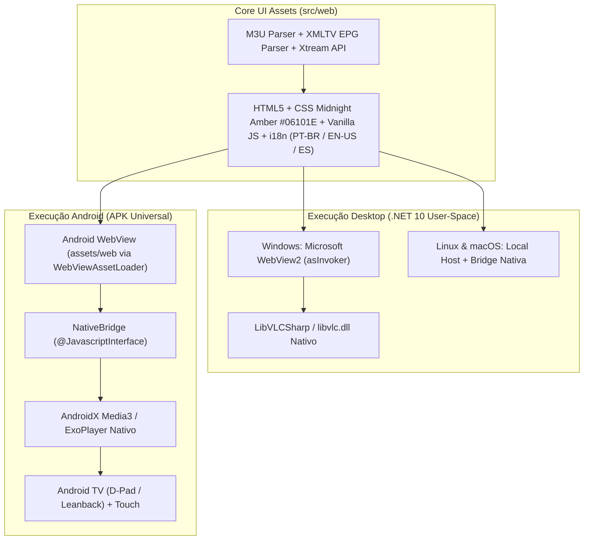

<p align="center">
  
</p>
<h1 align="center">FluiStream</h1>
<p align="center">
  <b>Reprodutor nativo moderno e fluido de listas M3U/M3U8 com EPG XMLTV e Xtream Codes API para Desktop Portable (Windows, Linux, macOS) e Android / Android TV.</b><br/>
  <i>Modern fluid native M3U/M3U8 playlist player with XMLTV EPG and Xtream Codes API for Portable Desktop (Windows, Linux, macOS) and Android / Android TV.</i><br/>
  <i>Reproductor nativo moderno y fluido de listas M3U/M3U8 con EPG XMLTV y API Xtream Codes para Desktop Portable (Windows, Linux, macOS) y Android / Android TV.</i>
</p>

<p align="center">
  <a href="https://github.com/CesarOvies/FluiStream/releases"></a>
  <a href="public/llms.txt"></a>
  
  
  
  
  <a href="LICENSE"></a>
</p>

<p align="center">
  💻 <a href="https://github.com/CesarOvies/FluiStream/releases"><strong>Baixar App Desktop Portable</strong></a> •
  📱 <a href="https://github.com/CesarOvies/FluiStream/releases"><strong>Baixar APK Android / TV</strong></a> •
  🤖 <a href="public/llms.txt"><strong>llms.txt (AI Index)</strong></a>
</p>

---

## Sumário
1. [Visão Geral](#visão-geral)
2. [Recursos Principais](#recursos-principais)
3. [Arquitetura & Fluxo](#arquitetura--fluxo)
4. [Downloads & Como Usar (v1.1.0)](#downloads--como-usar-v110)
5. [Compilação e Testes](#compilação-e-testes)
6. [Governança e Segurança](#governança-e-segurança)
7. [Isenção de Responsabilidade Legal](#isenção-de-responsabilidade-legal--legal-disclaimer)

---

## Visão Geral

O **FluiStream** é um reprodutor de mídia e listas IPTV (M3U / M3U8) **100% nativo multiplataforma** projetado segundo os padrões de engenharia de software de **Cesar Ovies**.

A partir da versão **v1.1.0**, a versão Web pública foi descontinuada em favor de clientes **100% nativos** (Desktop Portable e Android APK). Essa decisão elimina barreiras de navegadores como bloqueio de Mixed Content (HTTPS/HTTP), falhas de CORS em redirects 302, restrições de portas altas (Private Network Access) e limitações de codecs MPEG-TS/AC3/EAC3. A interface em `src/web/` atua como o **Core UI** compartilhado, executando em **User-Space (`asInvoker`)** no Desktop e com aceleração nativa no Android.

> [!NOTE]
> O **FluiStream** é um reprodutor de mídia neutro. Ele não inclui e nem fornece listas, canais ou conteúdos de terceiros; o usuário é responsável por carregar suas próprias listas legítimas.

---

## Recursos Principais

### 1. Home Hub Bento, Split-Pane & Organização Inteligente
- 🏠 **Home Hub Bento**: Painel inicial estilo Bento com cartões dedicados para **Ao Vivo (Live TV)**, **Filmes (VOD)**, **Séries**, **Live EPG**, **Favoritos**, **Catch-up**, **Master Search** (busca global unificada) e **Central de Notificações**.
- 🗂️ **Navegação Split-Pane**: Sidebar interativa com busca de categorias, filtros rápidos (`Tudo`, `Favoritos`, `Histórico`), ordenação alfabética/recente e grade de conteúdo com barra de progresso de reprodução e indicador de **Catch-up** (`catchup`, `catchup-days`, `catchup-source`, `tvg-shift`).
- 📺 **Ao Vivo (Live TV)**, 🎬 **Filmes (VOD)** e 🍿 **Séries (Series & Shows)** com agrupamento automático por Temporadas e Episódios (ex: `S01E02`, `1x05`, `Temporada 1`).

### 2. Gerenciador de Guia Eletrônico de Programação (EPG XMLTV)
- **EPG Embutido & Multi-Fonte**: Detecção automática de `x-tvg-url`/`url-tvg`, suporte a múltiplas fontes XMLTV mescladas (`mergeXml`) e envio de arquivo `.xml`.
- **EPG Timeline & Timeshift**: Visualização em linha do tempo dos próximos programas e ajuste fino de fuso horário (**Timeshift** de `-12h` a `+12h`).
- **Exibição em Tempo Real**: Cálculo dinâmico do programa em exibição, percentual decorrido na barra de progresso e próximos programas agendados.

### 3. Três Formas de Importação Flexíveis
1. **Arquivo Fixo Local**: Upload ou arraste (Drag & Drop) de arquivos `.m3u` ou `.m3u8`.
2. **URL Remota**: Download direto da lista via sockets nativos sem barreiras de CORS.
3. **API Xtream Codes**: Autenticação nativa utilizando Nome da Lista, Usuário, Senha e URL do Servidor (consumindo `player_api.php`, `get.php` e `xmltv.php`).

### 4. Motores Nativos de Vídeo (Desktop LibVLC + Android Media3)
- **Desktop (`.NET 10` + `WebView2` + `LibVLCSharp`)**: Reproduz diretamente fluxos MPEG-TS brutos contínuos, HLS, RTSP/RTMP e codecs de áudio proprietários (AC3/EAC3/DTS) com controle nativo de faixas e sem restrições de CORS.
- **Android & Android TV (`WebView` + `NativeBridge` + `AndroidX Media3 ExoPlayer`)**: Reprodução nativa acelerada por hardware para streams HTTP/HTTPS (HLS, DASH, MPEG-TS), com suporte completo a controle remoto (**D-Pad / Leanback**) e tela sensível ao toque.
- **Seletor de Estilo de Transmissão**: Escolha instantânea no player entre `Auto (HLS Adaptativo)`, `HLS (.m3u8)`, `MPEG-TS (.ts)` ou `Original (Direto)`.
- Ajuste de **Proporção de Tela (Aspect Ratio)**: Automático, 16:9 (Widescreen), 4:3 (Clássico) e Preencher (Fill).
- **Multi-Screen (Desktop/Web)** & **Controle Parental**: Grade simultânea com 6 layouts (`2x2`, `1+3`, `1+2`, `2+1`, `2x1`, `1x2`, até 4 slots HTML5/HLS) e bloqueio por PIN com hash **SHA-256** no Settings Hub.
- Sistema de **Favoritos** persistente, **Progresso de Reprodução** (`Continue Watching`) e histórico de canais recentes.

### 5. Padrões Cesar Ovies
- **Design Midnight Amber & Steel** (`#06101E` canvas, `#0F172A` surface, `#1E293B` border, `#F59E0B` amber accent, `#38BDF8` sky accent, `#10B981` emerald CTA).
- **i18n Obrigatório em 3 Idiomas**: Português do Brasil (`pt-BR`), Inglês (`en-US`) e Espanhol (`es`).
- **100% User-Space**: Sem exigência de permissões elevadas de Administrador (`asInvoker`).
- **Auto-Atualização Desktop Segura**: `UpdateService` com verificação semântica no GitHub Releases, validação criptográfica **SHA-256** e atualização atômica em segundo plano.

---

## Arquitetura & Fluxo



---

## Downloads & Como Usar (v1.1.0)

Acesse a aba **[Releases](https://github.com/CesarOvies/FluiStream/releases)** e baixe o pacote correspondente ao seu dispositivo:

| Plataforma | Formato | Pacote (v1.1.0) | Observações |
| :--- | :--- | :--- | :--- |
| 🪟 **Windows x64** | `.zip` | `FluiStream-v1.1.0-win-x64-portable.zip` | Executável portátil `FluiStream.exe` (.NET 10 WebView2 + LibVLC) |
| 🐧 **Linux x64** | `.tar.gz` / `.zip` | `FluiStream-v1.1.0-linux-x64-portable.tar.gz` | Binário nativo self-contained `FluiStream` |
| 🐧 **Linux ARM64** | `.tar.gz` / `.zip` | `FluiStream-v1.1.0-linux-arm64-portable.tar.gz` | Binário nativo self-contained para Raspberry Pi / ARM64 |
| 🍏 **macOS ARM64** | `.tar.gz` / `.zip` | `FluiStream-v1.1.0-osx-arm64-portable.tar.gz` / `.zip` | Binário nativo Apple Silicon (M1/M2/M3/M4) |
| 🤖 **Android & TV** | `.apk` | `FluiStream-v1.1.0-android.apk` | Universal (Celulares, Tablets, Android TV, Fire TV Stick, TV Box) |

### Desktop Portable (Windows, Linux, macOS)
1. Baixe e extraia o arquivo `.zip` ou `.tar.gz` para qualquer pasta (ex: Documentos ou Pendrive).
2. Execute o binário `FluiStream`. Zero instalador, zero privilégio de Administrador (100% User-Space).
3. Opcionalmente valide a integridade usando `SHA256SUMS.txt` ou `SHA512SUMS.txt` anexados na release.

### Android APK (Celular, Tablet e Android TV)
1. Baixe `FluiStream-v1.1.0-android.apk` na página de Releases.
2. No dispositivo Android ou Android TV / Fire TV, habilite a instalação de fontes desconhecidas e instale o APK (ou envie via `adb install FluiStream-v1.1.0-android.apk`).
3. Navegue livremente via **Touch** ou controle remoto (**D-Pad / Enter / Back**).

---

## Compilação e Testes

### Pré-requisitos
- **.NET 10.0 SDK** (para Desktop Portable)
- **Node.js 20+** (para suíte de testes unitários)
- **JDK 17 + Android SDK (Compile SDK 34)** (para compilação do APK Android)

### Execução dos Testes Locais
```powershell
# Executar suíte de testes unitários
node tests/run-tests.js
```

### Compilação do Executável Desktop
```powershell
# Compilação em modo Release
dotnet build src/desktop/FluiStream.Desktop.csproj -c Release --nologo
```

### Compilação do APK Android
```powershell
# 1. Sincronizar ativos do Core UI (src/web) para o projeto Android
New-Item -ItemType Directory -Force -Path src/android/app/src/main/assets/web | Out-Null
Copy-Item -Path src/web/* -Destination src/android/app/src/main/assets/web/ -Recurse -Force

# 2. Compilar APK de Release (ou assembleDebug para testes)
Push-Location src/android
./gradlew assembleRelease --no-daemon
Pop-Location
```

```bash
# Linux / macOS
mkdir -p src/android/app/src/main/assets/web
cp -r src/web/* src/android/app/src/main/assets/web/
cd src/android && chmod +x gradlew && ./gradlew assembleRelease --no-daemon
```

### Geração Completa dos Pacotes Desktop Multiplataforma
```powershell
# Executa o script oficial de build Desktop + hashes SHA-256/SHA-512
./build-all.ps1
```

---

## Governança e Segurança

- **Gitflow**: Ramificações `main` (releases de produção via PR) e `develop` (desenvolvimento contínuo).
- **Regra de Ouro 1**: Nenhum commit é realizado sem testes locais validados com sucesso.
- **Regra de Ouro 2**: Nenhum `git push` é realizado sem o consentimento explícito do usuário.
- **Zero Secrets**: Nenhuma credencial ou token reside no código cliente.
- **Verificação de Integridade**: Releases assinadas com hashes `SHA256SUMS.txt` / `SHA512SUMS.txt` e varredura **Microsoft Defender Deep Scan** (0 ameaças).

---

## Isenção de Responsabilidade Legal / Legal Disclaimer

> [!IMPORTANT]
> **Português**: O **FluiStream** é um reprodutor de software livre neutro desenvolvido para fins educacionais e interoperabilidade de mídias abertas. O software **NÃO** hospeda, não fornece, não distribui, não indexa e não comercializa nenhum tipo de lista de reprodução, canal de TV, filme, série ou fluxo de transmissão. O usuário é o único responsável pela legalidade, procedência e direitos autorais das listas M3U ou servidores Xtream que optar por reproduzir.
>
> **English**: **FluiStream** is a neutral, open-source media player developed for educational purposes and open-media interoperability. The software **DOES NOT** host, provide, distribute, index, or sell any playlist, TV channel, movie, series, or media stream. Users are solely responsible for the legality, licensing, and copyright compliance of the M3U playlists or Xtream servers they choose to play.
>
> **Español**: **FluiStream** es un reproductor de software libre neutral desarrollado con fines educativos y de interoperabilidad de medios abiertos. El software **NO** hospeda, proporciona, distribuye, indexa ni comercializa ningún tipo de lista de reproducción, canal de TV, película, serie o transmisión multimedia. El usuario es el único responsable de la legalidad, procedencia y derechos de autor de las listas M3U o servidores Xtream que decida reproducir.

---

<p align="center">
  Desenvolvido por <strong><a href="https://github.com/CesarOvies">Cesar Ovies</a></strong> sob a licença MIT.
</p>
