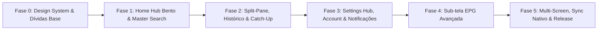

# Roteiro de Atualização de Identidade Visual & UX — FluiStream v2.0 ("Midnight Amber")

> [!NOTE]
> Documento elaborado via coordenação multiagente (**Ruflo**) sobre a branch `develop` (`03bbd6f`), mapeando as 8 telas de referência para a arquitetura multiplataforma do **FluiStream** (`src/web/`, `src/desktop/`, `src/android/`) em conformidade com os **Padrões de Engenharia Cesar Ovies**.

---

## 1. Visão Geral da Nova Identidade Visual

### 1.1 Conceito: **Midnight Amber & Steel** (Cinema / Smart TV Hub)
A identidade atual do FluiStream utiliza um layout utilitário de barra superior + grade única baseado na paleta plana **GitHub Dark** (`#0D1117` / `#161B22`). O objetivo desta atualização é evoluir o produto para uma experiência imersiva de **Smart TV / Cinema Hub**, mantendo 100% da portabilidade **User-Space (`asInvoker`)**, **DWM Dark Mode**, **i18n obrigatório em 3 idiomas (`pt-BR`, `en-US`, `es`)** e compatibilidade **Touch + D-Pad (Controle Remoto)**.

### 1.2 Sistema de Tokens & Paleta Proposta

| Token CSS (`:root`) | Valor Atual | Novo Valor Proposto | Aplicação Visual |
| :--- | :--- | :--- | :--- |
| `--bg-canvas` | `#0D1117` | `#06101E` | Fundo base Deep Navy Slate |
| `--bg-canvas-accent` | *(novo)* | `linear-gradient(135deg, #06101E 0%, #0D1F38 50%, #050B14 100%)` | Fundo geométrico com faixas diagonais metálicas e partículas âmbar leves |
| `--bg-surface` | *(ausente no `:root` atual)* | `rgba(15, 23, 42, 0.72)` | Painéis glassmorphic (`backdrop-filter: blur(12px)`) com fallback `#0F172A` |
| `--bg-sidebar` | *(novo)* | `#05070B` | Sidebar sólida de categorias no navegador Split-Pane |
| `--bg-tile-indigo` | *(novo)* | `#1A2352` | Tiles da central de Configurações (`Settings`) |
| `--accent-amber` | *(novo)* | `#F59E0B` (`#FBBF24` / `#FB923C`) | Grafismo de marca, borda de foco D-Pad / slot ativo e destaques |
| `--accent-crimson` | *(novo)* | `#8B1A24` | Destaque da categoria selecionada na sidebar |
| `--accent-blue` | `#388BFD` | `#38BDF8` (`#2563EB` → `#38BDF8`) | Aba ativa de EPG, ícones de Settings e anel de foco alternativo |
| `--accent-green` | `#238636` | `#10B981` (`#10B981` → `#16A34A`) | Tile Catch-Up, status `Active`, botão `BACK` e sucesso |
| `--grad-epg` | *(novo)* | `linear-gradient(135deg, #9333EA 0%, #C026D3 100%)` | Tile **Live with EPG** na Home |
| `--grad-fav` | *(novo)* | `linear-gradient(135deg, #06B6D4 0%, #2563EB 100%)` | Tile **Favourite** na Home |
| `--grad-catchup` | *(novo)* | `linear-gradient(135deg, #10B981 0%, #16A34A 100%)` | Tile **Catch Up** na Home |
| `--grad-logout` | *(novo)* | `linear-gradient(90deg, #F43F5E 0%, #FB923C 100%)` | Botão `LOGOUT` / ações destrutivas suaves |
| `--text-primary` | `#E6EDF3` | `#F0F6FC` | Títulos, rótulos e textos principais |
| `--text-secondary` | `#8B949E` | `#94A3B8` | Subtítulos, contadores e metadados |

### 1.3 Evolução da Marca (`logo.svg`, `app.ico`, Android Icons & Banner)
- **Logotipo**: Evoluir [logo.svg](file:///src/web/assets/logo.svg) para um símbolo Play/Chevron estilizado com fluxo dinâmico em gradiente âmbar-dourado-laranja (`#FBBF24` → `#F97316` → `#EF4444`), preservando leitura nítida em 24px (header), 88px (modais) e 512px (ícones).
- **Ativos Nativos a Sincronizar**:
  - Web/PWA: `src/web/assets/logo.svg`, `icon-192.png`, `icon-512.png`, `apple-touch-icon.png`, `favicon.ico`.
  - Desktop: `src/desktop/app.ico`, `MainForm.cs` (`BackColor`, `DefaultBackgroundColor`, modais escuros).
  - Android/TV: `src/android/app/src/main/res/drawable/ic_launcher_background.xml`, `ic_launcher_foreground.xml`, `tv_banner.xml`, `values/colors.xml`, `drawable/tv_button_bg.xml`, `layout/activity_main.xml` e `AppUpdateManager.kt`.
  - Descoberta IA/SEO: atualizar a seção de paleta em [llms-full.txt](file:///public/llms-full.txt) após a implementação.

---

## 2. Mapeamento Tela a Tela (Prints de Referência → FluiStream)

| Print | Tela de Referência | Estado Atual no FluiStream | Evolução Planejada |
| :---: | :--- | :--- | :--- |
| **1** | **Home Hub (Bento Dashboard)** | App abre direto em `#empty-state-view` ou `#main-content-view` na aba `live` (`src/web/index.html`) | Novo `#home-hub-view` como tela inicial com relógio/data ao vivo, **Master Search**, barra de ícones rápidos, Bento Grid (`LIVE TV`, `MOVIES`, `SERIES`, `LIVE WITH EPG`, `FAVOURITE`, `CATCH UP`, painel `Featured/Recents`), refresh individual e rodapé de expiração. |
| **2** | **Navegador Split-Pane (Categorias + Grade)** | `#category-overview-section` troca para `#channel-grid-section` sem sidebar persistente (`#category-filter-list` órfão em `app.js`) | Layout Split-Pane: sidebar escura `#05070B` à esquerda (`←`, logo, `×`, busca em categorias, `ALL`, `FAVOURITES`, `CHANNELS HISTORY`, categorias com contagem e destaque `#8B1A24`) + grade glassmorphic à direita com busca e menu `⋮`. |
| **3 & 5** | **Central de Configurações (Grid de Tiles)** | `#modal-settings` é um formulário plano com 4 campos (`index.html:371-446`) | Tela/overlay `#settings-hub-view` em grid 3 colunas com tiles `#1A2352`: `General Settings`, `EPG`, `Stream Format`, `Time Format`, `Automation`, `Parental Control`, `MULTI-SCREEN`, `Speed Test`, `Network / Proxy`, `Switch Device Mode`, `Account Info`. |
| **4** | **Subscription / Account Info** | `#modal-account` exibe snapshot estático capturado apenas na importação; `server_info` de `XtreamApi.authenticate()` é descartado | Tela/card glassmorphic `Subscription Info` com refresh em tempo real de `user_info` e `server_info` (`active_cons`, `status`, `exp_date`), badge verde `Active` e botões duplos inferiores em gradiente (`BACK` e `LOGOUT`, mantendo acesso a `EDIT PROFILE`). |
| **6** | **Multi-Screen Layout Picker** | Inexistente; apenas 1 instância de `VideoPlayerController` e `#main-video` | Modal `Choose Multi-Screen Layout` com 6 templates visuais (2×2, 1+3, 1+2, 2+1, 2 lado a lado, 2 empilhados) + grid interativo com foco âmbar e slots `+`. |
| **7** | **Central de Notificações** | Apenas `#update-toast` flutuante para updates do GitHub | Tela/drawer `Notifications` acessível pelo ícone de sino no header, com histórico de alertas (nova versão, expiração próxima, falha/sucesso de EPG, erros de stream) e estado vazio limpo. |
| **8** | **Sub-tela Settings \| EPG** | Apenas 1 input de URL XMLTV por perfil; `EPGParser.getUpcomingPrograms()` não é usado na UI | Sub-tela split-pane `Settings | EPG` com rail esquerdo (`EPG SOURCES`, `EPG TIMELINE`, `EPG TIMESHIFT`), múltiplas fontes XMLTV, contagem de canais mapeados e timeline horizontal. |

---

## 3. Contratos Nativos & Dívidas Técnicas Identificadas na Auditoria

Antes de aplicar a nova UI, o roteiro corrige dívidas reais detectadas em `src/web/`, `src/desktop/` e `src/android/` e protege contratos críticos entre WebView e código nativo:

### 3.1 Contratos DOM Obrigatórios (Não Quebrar)
1. **Desktop LibVLC (`src/desktop/MainForm.cs` → `UpdateVideoViewLayout`)**:
   - C# consulta `document.getElementById('player-wrapper').getBoundingClientRect()` multiplicado por `window.devicePixelRatio` para posicionar o HWND nativo `_videoView` acima do WebView2.
   - Qualquer novo layout de player (fullscreen, player embutido no navegador ou multi-screen) precisa manter `#player-wrapper` íntegro ou enviar `VLC_PLAYER_COMMAND` (`SET_VISIBILITY`) antes de sobrepor modais/menus.
   - Callbacks globais exigidos pelo C#: `window.fluiStreamApp.handlePlayerState`, `handleVlcTimeUpdate`, `handleNativeTracks`, `handleHardwareVolume` e `window.__onNativeFetchResult`.
2. **Android / Android TV (`src/android/.../MainActivity.kt` → `handleBackNavigation`)**:
   - O botão `BACK` do controle remoto/sistema avalia exatamente os seletores `.modal-backdrop:not(.hidden)`, `.seasons-popup-backdrop:not(.hidden)`, `.modal-close-btn`, `#btn-close-seasons-popup`, `#btn-back-categories` e `#category-nav-bar`.
   - Ao introduzir a Home Hub e as novas sub-telas (`#settings-hub-view`, `#notifications-view`, `#epg-settings-view`, `#multiscreen-view`), atualizar `MainActivity.kt` para reconhecer uma pilha de navegação unificada (ex: `window.fluiStreamApp.handleNativeBack()` com fallback para os seletores legados).
3. **Sincronização de Ativos Android**:
   - `src/android/app/src/main/assets/web/` é versionado no repositório e não possui task de cópia automática no `build.gradle.kts`. Todo PR que alterar `src/web/` deve sincronizar `src/android/app/src/main/assets/web/` localmente antes dos testes finais.

### 3.2 Dívidas Técnicas a Sanear Durante o Roadmap
- **CSS (`src/web/css/style.css`)**: definir `--bg-surface` em `:root`, criar regra `.btn-icon`, e remover estilos órfãos (`.cat-pill`, `#category-filter-list`) ao migrar para a nova sidebar.
- **Storage (`src/web/js/storage.js`)**:
  - Expor `storage.getRecents()` na seção `CHANNELS HISTORY` da nova sidebar e no painel da Home.
  - Corrigir `storage.clearAll()` para limpar também `fluistream_favorites_*`, `fluistream_recents_*` e `fluistream_settings`.
  - Unificar os nomes de propriedades Xtream entre `handleImportSubmit` (`xtreamServer`/`xtreamUser`/`xtreamPass`) e `openEditProfileModal` (`url`/`serverUrl`/`username`/`password`).
- **i18n Desktop (`src/desktop/MainForm.cs`)**: mover as 3 strings PT-BR hardcoded (`_btnExitFullscreen`, título e fallback de notas em `ShowUpdatePrompt`) para `LocalizationService.cs` (`pt-BR`, `en-US`, `es`).
- **Navegação D-Pad (`src/web/js/app.js`)**: separar navegação espacial de foco entre cards/tiles (setas no grid/Home) dos atalhos exclusivos do player ativo.

---

## 4. Roteiro de Implementação em Fases

### Fase 0 — Fundação de Design System, Marca & Saneamento Base
- **Escopo**:
  - Criar tokens da paleta **Midnight Amber & Steel** em `src/web/css/style.css`, corrigindo `--bg-surface` e `.btn-icon`.
  - Criar fundo geométrico leve em CSS/SVG (sem imagens raster pesadas para preservar desempenho em TV Box e Single-File Desktop).
  - Atualizar logotipo (`src/web/assets/logo.svg`, ícones PWA, `src/desktop/app.ico`, `src/android/.../res/drawable/ic_launcher_*` e `tv_banner.xml`).
  - Atualizar cores nativas (`src/desktop/MainForm.cs`, `src/android/.../res/values/colors.xml`, `tv_button_bg.xml`, `activity_main.xml`, `AppUpdateManager.kt`) e remover strings hardcoded do `MainForm.cs` movendo-as para `LocalizationService.cs`.
  - Corrigir `storage.clearAll()` e normalização de campos Xtream em `storage.js` / `app.js`.
- **Critério de Aceite**:
  - `node tests/run-tests.js` e `dotnet build src/desktop/FluiStream.Desktop.csproj -c Release` passando 100%.
  - Zero regressão de contraste e DWM Dark Mode ativo no Windows.

### Fase 1 — Home Hub Bento Dashboard, Relógio ao Vivo & Master Search
- **Escopo**:
  - Implementar `#home-hub-view` (Print 1) como landing screen quando houver perfil ativo (mantendo `#empty-state-view` estilizado quando não houver nenhuma lista).
  - Header com relógio/data reativos ao idioma (`pt-BR`, `en-US`, `es`) e preferência `12h/24h`, botão **Master Search** (modal/overlay de busca unificada em `Live + Movies + Series + EPG`), e barra de ícones de acesso rápido.
  - Cards principais `LIVE TV`, `MOVIES`, `SERIES` com timestamp `Last updated` e botão de atualização rápida (`↻`) por categoria ou perfil.
  - Tiles gradientes `LIVE WITH EPG`, `FAVOURITE` e `CATCH UP` + painel direito `Featured / Continuar Assistindo` + rodapé de expiração.
- **Critério de Aceite**:
  - Todas as strings traduzidas nos 3 idiomas em `src/web/js/localization.js` (teste de paridade i18n verde).
  - Navegação funcional por Mouse/Touch e D-Pad (`Enter`/`DPAD_CENTER`).

### Fase 2 — Navegador Split-Pane, Histórico, Séries & Catch-Up
- **Escopo**:
  - Substituir o fluxo antigo de categorias pelo layout Split-Pane (Print 2): sidebar `#05070B` à esquerda (`ALL`, `FAVOURITES`, `CHANNELS HISTORY`, lista pesquisável de categorias com contadores) + grade glassmorphic à direita.
  - Conectar `CHANNELS HISTORY` a `storage.getRecents()` e adicionar barra de progresso/retomada (`Continuar Assistindo`) em Filmes e Séries.
  - Estender `src/web/js/m3u-parser.js` para ler atributos `catchup`, `catchup-days`, `catchup-source` e `tvg-shift`, habilitando o tile **CATCH UP** (com ocultação ou estado informativo claro caso a lista atual não possua canais com catch-up).
  - Atualizar `MainActivity.kt#handleBackNavigation` e `app.js` para retorno limpo: `Player -> Grade/Split-Pane -> Home Hub -> Sair (double back)`.
- **Critério de Aceite**:
  - Performance validada para 10.000+ itens (< 20ms no agrupamento/paginação em `tests/run-tests.js`).
  - Back do Android TV retorna corretamente entre telas sem fechar o app acidentalmente.

### Fase 3 — Settings Tile Hub, Subscription Info & Central de Notificações
- **Escopo**:
  - Transformar `#modal-settings` na central em grid de 3 colunas (Prints 3 e 5), mantendo todas as opções existentes (Idioma, Motor HLS/VLC, Modo de Transmissão, Proxy CORS / Local Bridge, Check Updates, Limpar Dados) integradas nos novos tiles (`General Settings`, `Stream Format`, `Network / Proxy`).
  - Implementar novos módulos:
    - `Time Format` (`12h` / `24h`).
    - `Automation` (auto-atualização de lista/EPG ao abrir, auto-play próximo episódio, checagem de versão).
    - `Parental Control` (PIN local SHA-256 em User-Space para proteger categorias adultas/selecionadas).
    - `Switch Device Mode` (`Auto`, `TV / D-Pad`, `Desktop`, `Mobile`) ajustando densidade de cards e foco.
    - `Speed Test` (medição real de download/latência no cliente contra endpoint configurável ou CDN de teste).
  - Atualizar `Subscription Info` (Print 4) para consultar `XtreamApi.authenticate()` em tempo real (exibindo `active_cons`, `max_connections`, `status`, `exp_date`, `is_trial`, `created_at`) com botões inferiores em gradiente (`BACK` / `LOGOUT`).
  - Implementar **Central de Notificações** (Print 7) acessível pelo sino do header, agregando avisos de update do app, expiração próxima de lista Xtream, sincronização EPG e erros recentes.
- **Critério de Aceite**:
  - Zero segredos expostos; PIN parental armazenado como hash com salt local; `pt-BR`, `en-US` e `es` 100% sincronizados.

### Fase 4 — Sub-tela `Settings | EPG` (Sources, Timeline & Timeshift)
- **Escopo**:
  - Criar a sub-tela split-pane do Print 8 com rail esquerdo (`EPG SOURCES`, `EPG TIMELINE`, `EPG TIMESHIFT`).
  - Suporte a múltiplas fontes XMLTV por perfil (`+ ADD SOURCE`, `↻ REFRESH EPG`, status `Loaded`/`Failed` e contador de canais resolvidos).
  - Visualização **EPG Timeline** horizontal consumindo `EPGParser.getUpcomingPrograms()` + filtro por canal/categoria.
  - Controle de **EPG Timeshift** (`-12h` a `+12h`) aplicado no cálculo de horário do `EPGParser`.
- **Critério de Aceite**:
  - Novos testes unitários em `tests/run-tests.js` cobrindo Timeshift e múltiplas fontes XMLTV.

### Fase 5 — Multi-Screen, Paridade Nativa, SEO/IA & Validação Final
- **Escopo**:
  - Implementar modal `Choose Multi-Screen Layout` (Print 6) com os 6 layouts (2×2, 1+3, 1+2, 2+1, 2×1 vertical, 1×2 horizontal).
  - **Estratégia Multi-Motor**:
    - *Web / HLS.js*: suporte completo a até 4 players `<video>` + `Hls` simultâneos com seletor de áudio ativo por foco.
    - *Desktop LibVLC (`MainForm.cs`)*: evoluir de `_videoView` único para pool de até 4 `VideoView` + `MediaPlayer` posicionados por array de rects via `VLC_LAYOUT_UPDATE` (ou fallback HLS no WebView2 para slots secundários).
    - *Android Media3 (`VideoPlayerManager.kt`)*: avaliar suporte a 2–4 `PlayerView`/`ExoPlayer` simultâneos com limitação segura configurável por capacidade de decodificação de hardware do dispositivo.
  - Sincronizar `src/web/*` → `src/android/app/src/main/assets/web/`.
  - Atualizar `README.md`, `public/llms.txt`, `public/llms-full.txt` e versão semântica (`version.js`, `package.json`, `build.gradle.kts`, `FluiStream.Desktop.csproj`).
- **Critério de Aceite**:
  - `node tests/run-tests.js` 100% verde.
  - `dotnet build src/desktop/FluiStream.Desktop.csproj -c Release` com 0 erros.
  - `./gradlew assembleRelease` (CI/local) sem erros.

---

## 5. Organização de Agentes (Topologia Hierárquica Ruflo)

Para executar as fases acima em paralelo sem colisões de arquivo, o fluxo foi estruturado no **Ruflo** com topologia `hierarchical` (até 5 agentes especializados por sprint):

| Agente (Ruflo) | Tipo | Escopo Exclusivo de Arquivos | Responsabilidade |
| :--- | :--- | :--- | :--- |
| `ui-coordinator` | `coordinator` | Coordenação / Swarm State | Divide entregas por fase, gerencia handoffs e gates de aceite. |
| `ui-researcher` | `researcher` | Leitura de referências, DOM e contratos | Mapeia requisitos de UX, tokens, ícones e compatibilidade com TV/Desktop. |
| `cross-platform-architect` | `architect` | `src/desktop/*.cs`, `src/android/**/*`, `public/*` | Define contratos de ponte (`MainForm.cs`, `MainActivity.kt`, `TvFocusHelper.kt`), DWM Dark Mode e paridade de cores nativas. |
| `roadmap-author` / `coder` | `coder` | `src/web/**/*`, `docs/*` | Implementa Design System, views HTML/CSS/JS, parsers e 3 idiomas em `localization.js`. |
| `ci-tester` & `qa-reviewer` | `tester` / `reviewer` | `tests/run-tests.js`, validação pós-edição | Executa testes unitários, `dotnet build`, valida paridade `pt-BR`/`en-US`/`es`, checa User-Space e sincronia `assets/web/`. |
